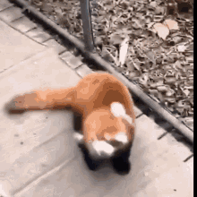

# buttery: a video editor with manual motion smoothing

[](https://mcandre.github.io/buttery/) [](https://pkg.go.dev/github.com/mcandre/buttery) [](https://github.com/mcandre/buttery/actions) [](LICENSE.md) [](AI-DECLARATION.md) [](https://github.com/sponsors/mcandre)


# SUMMARY

`buttery` smoothes out transitions at the ends of animated GIFs.

For details on tuning buttery, see [CONFIGURATION](CONFIGURATION.md).

For details on building from source, see [DEVELOPMENT](DEVELOPMENT.md).

# EXAMPLES

Found in the [examples/](examples) directory.

## Default Loop Stitch

By default, buttery smoothes out animations by copying frames in reverse. As well, the GIF loop count flag is set to infinite.

Homer changes from popping instantaneously out of a bush, to emerging back out of a bush.

| Before | After |
| :----: | :---: |
|  |  |

```sh
buttery homer.gif
```

## Color Fading

The classic fade-to-black (or orange!) transition. Dream-like.

| Before | After |
| :----: | :---: |
|  |  |

```sh
buttery -stitch Fade -fadeColor "#CC5500" red-panda.gif
```

## FlipH/FlipV

Reflecting frames around a horizontal or vertical axis, starting at the animation halfway point in time, is another great way to smooth out transitions.

| Before | After |
| :----: | :---: |
|  |  |

```sh
buttery -transparent -stitch FlipH cinnamoroll.gif
```

Run `buttery -help` for even more options.

# RESOURCES

Prior art and personal plugs.

* [ffmpeg](https://ffmpeg.org/) edits and converts videos
* [gifenc.sh](https://github.com/thevangelist/FFMPEG-gif-script-for-bash) converts numerous video formats to animated GIF's
* [ImageMagick](https://imagemagick.org/#gsc.tab=0) converts between multimedia formats, including GIF and WEBP
* [mcandre/harmonica](https://github.com/mcandre/harmonica) repackages comic archives
* [mcandre/tigris](https://github.com/mcandre/tigris) provides (Kindle) comic book archival utilities
* [mkvtools](https://emmgunn.com/wp/mkvtools-home/) edits MKV videos
* [VLC](https://www.videolan.org/vlc/) plays numerous multimedia formats
* [webm](https://www.webmproject.org/) supports audio in animation loops

🧈
